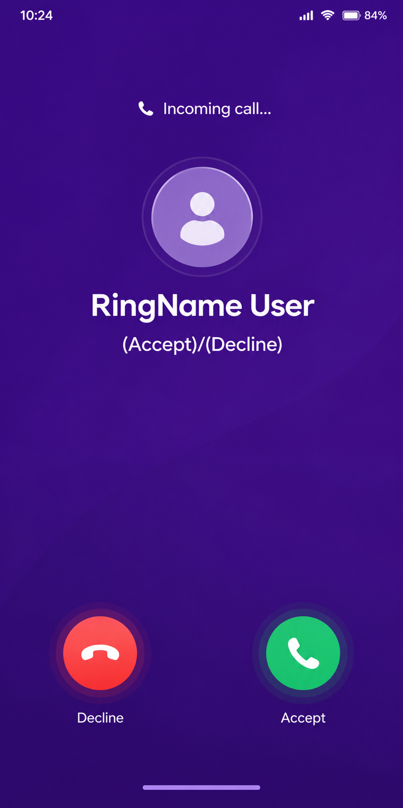

<div align="center">

# 📞 RingName

**Every Call. Your Name.**

[](https://flutter.dev/)
[](https://dart.dev/)


*Tired of seeing random numbers when your phone rings? With RingName, you can assign ONE custom name to ALL unknown phone numbers. When an unsaved number calls, you see the name you chose!*

</div>

---

## 📸 App Showcase

*(Note: Replace these placeholder images with your actual app screenshots once the UI is complete!)*

<table>
  <tr>
    <td align="center"><b>1. Set Global Name</b></td>
    <td align="center"><b>2. Receive Unknown Call</b></td>
  </tr>
  <tr>
    <td></td>
    <td></td>
  </tr>
</table>

---

## ⚙️ How It Works Visually

1. 📝 **Set the Name:** Open the app and set a global name for unknown callers (e.g., "RingName User" or "Unregistered Caller").
2. 📱 **Native Interception:** When a call comes in, Android checks your native contacts.
3. 🎉 **Result:** If the number is **NOT** in your contacts, RingName intercepts the call and displays your chosen global name!

---

## ✨ Core Features
- 🏷️ **Global Caller ID:** Apply one custom name to all non-contact incoming calls.
- 🔒 **100% Offline & Private:** Your preference is stored locally on your device. No cloud uploads.
- 🤖 **Deep Android Integration:** Leverages Android's native call screening features to seamlessly detect incoming calls and overlay your mapped name.

---

## 🛠️ Tech Stack
- **Framework:** [Flutter](https://flutter.dev/) (Dart)
- **State Management & Routing:** [GetX](https://pub.dev/packages/get)
- **Architecture:** Feature-based MVVM (Model-View-ViewModel)
- **Local Storage:** [shared_preferences](https://pub.dev/packages/shared_preferences)
- **Native Android Bridge:** Kotlin Method Channels for Call Screening

---

## 🚀 Getting Started

### Prerequisites
- Flutter SDK (>=3.0.0)
- Android Studio / VS Code
- A real Android Device (Native call interception features cannot be fully tested on standard emulators)

### Installation
1. **Clone the repository:**
   ```bash
   git clone https://github.com/rudramadhab22/ringname.git
   ```
2. **Navigate to the directory:**
   ```bash
   cd ringname
   ```
3. **Install dependencies:**
   ```bash
   flutter pub get
   ```
4. **Run the app:**
   ```bash
   flutter run
   ```

---

## 📂 Project Structure
```text
lib/
 ┣ core/              # Theme, Routing, and App-wide Utilities
 ┣ data/              # Local Storage Providers
 ┣ features/          # UI Screens (Home)
 ┃ ┣ home/
 ┃ ┃ ┣ presentation/  # Views and GetX Controllers
 ┃ ┃ ┗ ...
 ┗ main.dart          # Application Entry Point
```

<div align="center">
  <p>Made with ❤️ for a better calling experience.</p>
</div>
